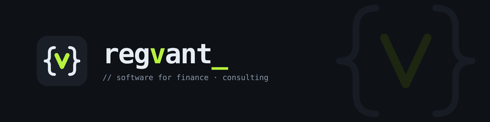

<p align="center">
  
</p>

<p align="center">
  <a href="https://regvant.com"></a>
  <a href="mailto:info@regvant.com"></a>
  <a href="https://www.linkedin.com/company/[linkedin-sayfasi]"></a>
</p>

```js
const regvant = {
  name:     "Regvant Tech",
  based_in: "Istanbul, Türkiye",
  builds:   ["software for finance · consulting"],
  offers:   ["IT consulting"],
};
```

## About us

**Regvant** builds software for the finance sector and provides IT consulting to the institutions that use it.

The name comes from **reg**ulation + ad**vant**age: in finance, getting the rules right is where the advantage starts.

### What we do

- **Software development:** applications and integrations built for financial institutions
- **IT consulting:** helping teams plan, run and improve their technology

### Get in touch

- 🌐 [regvant.com](https://regvant.com)
- ✉️ [info@regvant.com](mailto:info@regvant.com)

<p align="center">
  <br>
  <sub>© Regvant Tech</sub>
</p>
